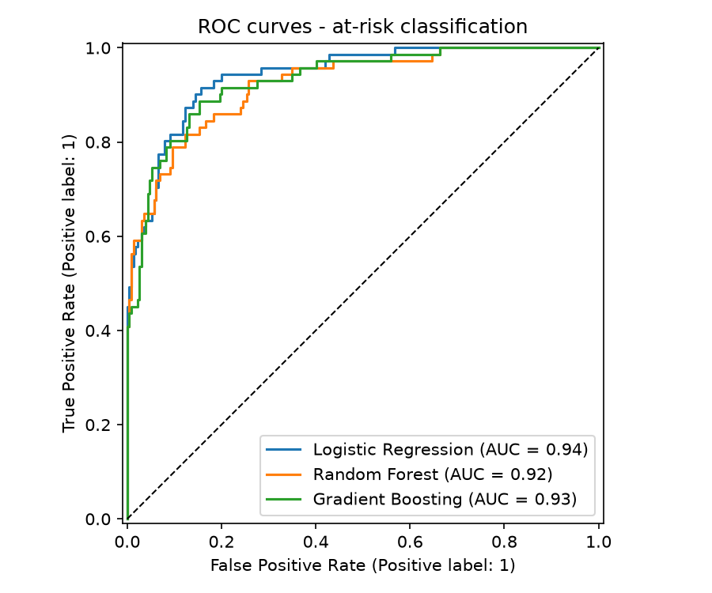
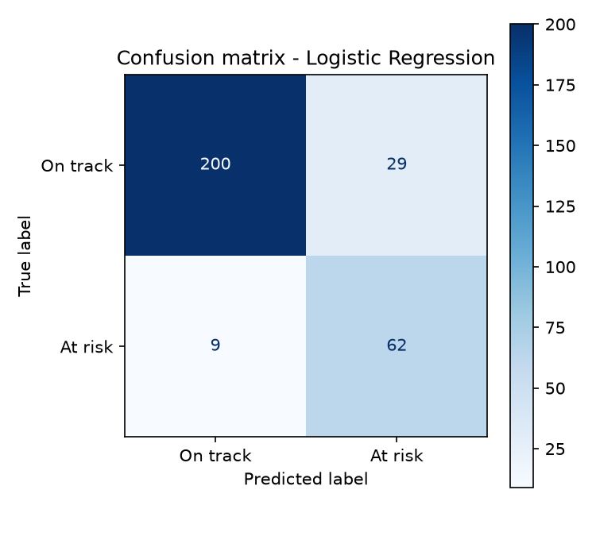
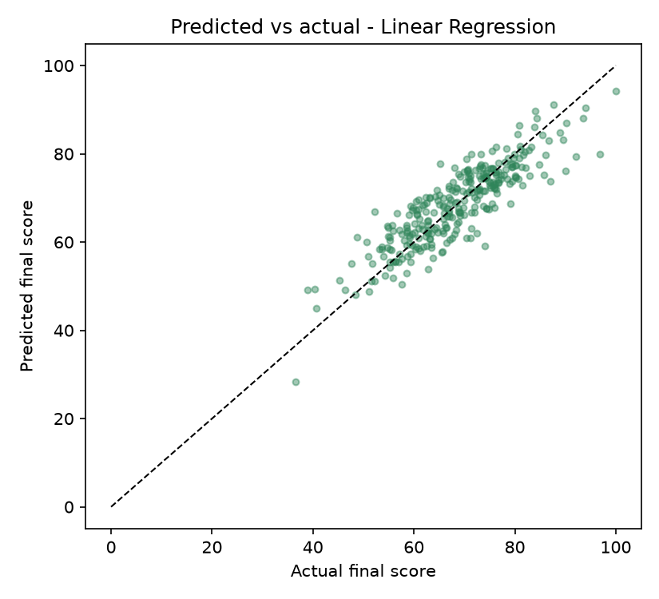
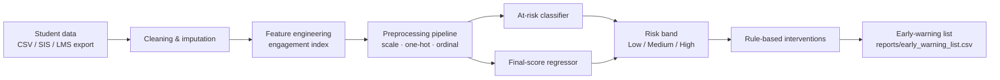

# AI-Based Student Academic Performance Prediction

An early-warning system built with machine learning. It predicts which students are **at risk of failing** (final score < 60) and estimates each student's **final score**, so advisors can step in before the semester ends.

> **Academic project** — M.S. Information Science & Technology, University of Wisconsin–Milwaukee.
> The repository ships with a **synthetic dataset** (`src/generate_data.py`) shaped like public education datasets, so the full pipeline runs end to end without exposing real student records.

   

---

## Problem

Instructors usually find out a student is struggling only after the final grade is in. This project uses data that is available **mid-semester** (attendance, LMS activity, coursework completion, midterm score, prior GPA and background factors) to:

1. **Classify** each student as *at risk* / *on track* (binary classification)
2. **Predict** the final course score (regression)
3. **Recommend** a concrete intervention for every flagged student

## Results (held-out test set, 20%)

| Task | Best model | Key metrics |
|---|---|---|
| At-risk classification | Logistic Regression | **ROC-AUC 0.94** · Recall 0.87 · Accuracy 0.87 · F1 0.77 |
| Final-score regression | Linear Regression | **R² 0.76** · MAE 4.0 pts · RMSE 5.0 pts |

Each model was chosen by 5-fold cross-validation (classification CV ROC-AUC 0.93 ± 0.01), compared against Random Forest and Gradient Boosting. The interpretable linear models won, which matters here because advisors need to see *why* a student was flagged.

**Strongest predictors** (permutation importance): midterm score, number of past failures, weekly study hours, prior GPA, parental education.

| ROC curves | Feature importance |
|---|---|
|  |  |

| Confusion matrix | Predicted vs actual |
|---|---|
|  |  |

All metrics are in [`reports/metrics.json`](reports/metrics.json).

## Architecture



## Repository layout

```
├── data/students.csv            # synthetic dataset (1,500 students, 17 features)
├── docs/
│   ├── Project_Report.md        # full write-up: problem, method, results, ethics
│   ├── Data_Dictionary.md       # every column, type, range, meaning
│   └── Methodology.md           # pipeline, model selection, evaluation protocol
├── reports/
│   ├── figures/                 # EDA + evaluation charts
│   ├── metrics.json             # all model scores
│   └── early_warning_list.csv   # scored output with recommended actions
├── src/
│   ├── generate_data.py         # reproducible synthetic data generator
│   ├── features.py              # feature engineering + sklearn ColumnTransformer
│   ├── train.py                 # train / cross-validate / evaluate / persist models
│   └── predict.py               # batch scoring + intervention recommendations
└── tests/test_pipeline.py       # pytest unit tests
```

## Quick start

```bash
git clone https://github.com/saivamsi462000/student-performance-prediction.git
cd student-performance-prediction
python -m venv .venv && source .venv/bin/activate
pip install -r requirements.txt

python -m src.generate_data          # 1. build the dataset
python -m src.train                  # 2. train + evaluate, write figures and metrics
python -m src.predict                # 3. score students -> early-warning list
pytest -q                            # 4. run tests
```

To use a real dataset, provide a CSV with the columns in [`docs/Data_Dictionary.md`](docs/Data_Dictionary.md) and pass `--data path/to/file.csv`.

## Sample output

| student_id | risk_probability | predicted_final_score | risk_band | recommended_action |
|---|---|---|---|---|
| S10xxxx | 0.99 | 41.3 | High | attendance outreach; refer to tutoring; academic advisor meeting |
| S10xxxx | 0.47 | 61.8 | Medium | coursework check-in |
| S10xxxx | 0.02 | 84.5 | Low | monitor |

## Tech stack

Python · pandas · NumPy · scikit-learn (Pipeline, ColumnTransformer, Logistic Regression, Random Forest, Gradient Boosting, permutation importance) · Matplotlib · joblib · pytest

## Responsible use

Predictions should **support** advisors, not replace them. See the ethics section of the [project report](docs/Project_Report.md#7-ethics-fairness-and-privacy) for the fairness checks, data-privacy (FERPA) considerations and known limitations.

## Author

**Gopi Satya Sai Vamsi** · [LinkedIn](https://www.linkedin.com/in/sai-vamsi-2740621ab/) · [GitHub](https://github.com/saivamsi462000)
