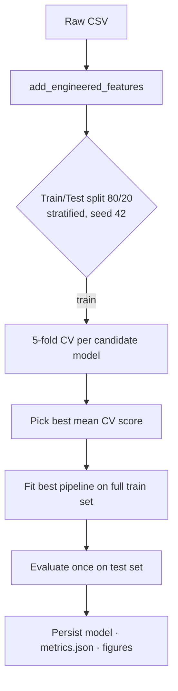

# Methodology

## Pipeline

Every transformation (imputation, scaling, encoding) lives **inside** an sklearn `Pipeline`, so it is fitted only on training folds. That prevents information from the validation or test data leaking into preprocessing.

## Preprocessing

| Group | Columns | Steps |
|---|---|---|
| Numeric | age, study hours, attendance, sleep, GPA, failures, LMS logins, assignment %, midterm, engagement index | median impute → StandardScaler |
| Binary | gender, internet, job, extracurricular, tutoring | most-frequent impute → OneHotEncoder(drop="if_binary") |
| Ordinal | parental_education | most-frequent impute → OrdinalEncoder (fixed order) |

## Model selection

- **Classification metric:** ROC-AUC for selection (threshold-independent), with **recall** reported as the operational metric.
- **Regression metric:** R² for selection, with MAE reported in grade points.
- **Candidates:** a linear baseline, a bagging ensemble (Random Forest) and a boosting ensemble (Gradient Boosting), all with sensible defaults. Hyperparameter search (GridSearchCV) is a planned extension. The aim here was a fair comparison between model families.

## Explainability

Permutation importance on the test set: each feature is shuffled 10 times and the mean drop in ROC-AUC is recorded. Unlike impurity-based importance, this method works the same way for any model and is not biased toward high-cardinality features.

## Reproducibility

- Fixed seed (`42`) for data generation, splits and models
- `requirements.txt` pins minimum versions
- `pytest` checks the data schema, reproducibility, missing-value handling, that the model beats a majority-class baseline, and the intervention rules
