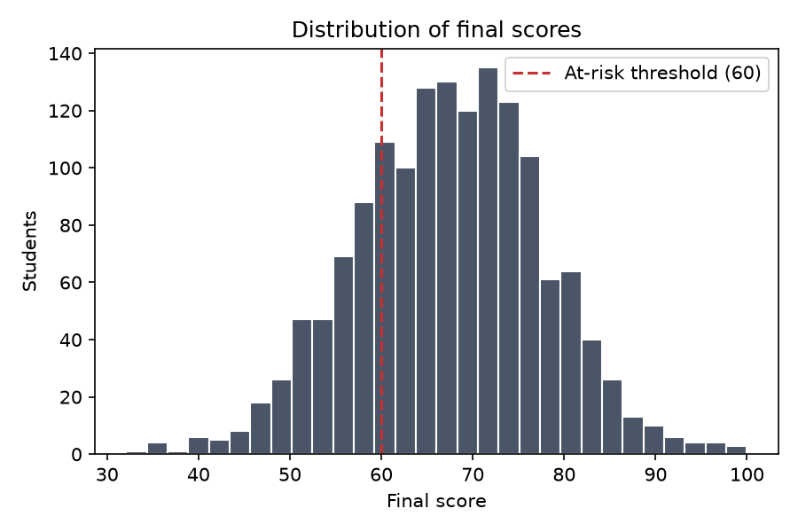
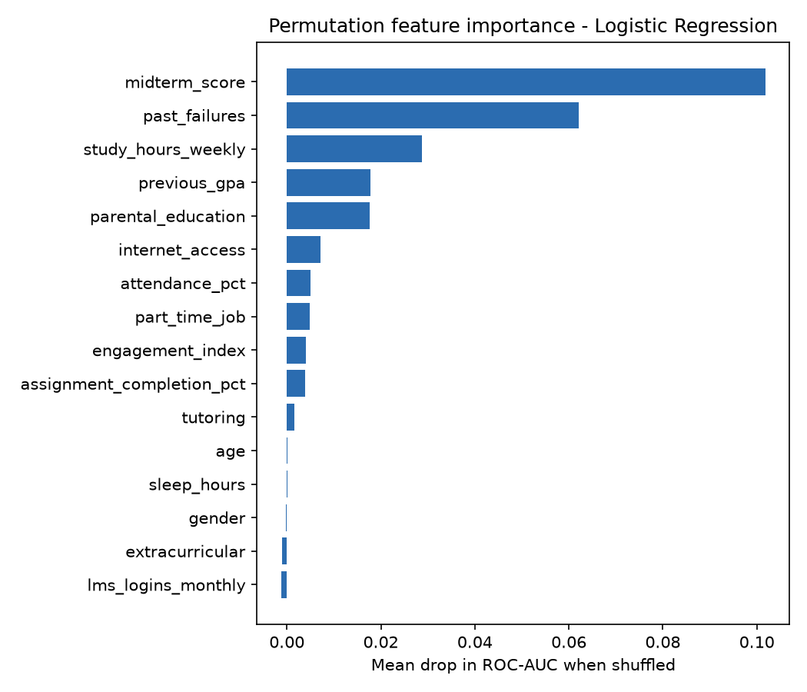

# Project Report: AI-Based Student Academic Performance Prediction

**Author:** Gopi Satya Sai Vamsi
**Program:** M.S. Information Science & Technology, University of Wisconsin–Milwaukee
**Type:** Academic project

---

## 1. Executive summary

This project builds a machine-learning early-warning system that flags students likely to fail a course while there is still time to help them. Using mid-semester signals (attendance, LMS engagement, assignment completion, midterm score, prior GPA and background factors), the best classifier reaches **0.94 ROC-AUC** and catches **87% of at-risk students** on held-out data. A companion regression model predicts final scores with a **mean absolute error of about 4 points**. Every flagged student gets a specific recommended intervention.

## 2. Problem statement and objectives

Course failure is usually discovered when final grades are posted, which is too late to act. The objectives were to:

- **O1:** Predict at-risk status (final score < 60) from data available by mid-semester.
- **O2:** Predict the numeric final score so advisors can rank students by severity.
- **O3:** Explain which factors drive risk, so interventions target root causes.
- **O4:** Produce an actionable output (a ranked list with recommended actions), not just a model.

**Success criteria:** ROC-AUC ≥ 0.85 and recall ≥ 0.80 for the at-risk class. Recall is prioritised because missing a struggling student costs more than an unnecessary check-in.

## 3. Data

- **Source:** a reproducible synthetic dataset of 1,500 students (`src/generate_data.py`) modelled on the structure of public education datasets such as the UCI Student Performance data. Using synthetic data avoids handling real student records protected under FERPA.
- **Features (16):** demographics, family background, study behaviour, engagement and prior performance. See [Data_Dictionary.md](Data_Dictionary.md).
- **Targets:** `at_risk` (binary, 23.5% positive) and `final_score` (0–100).
- **Data quality:** about 2% missing values were injected into `sleep_hours`, `lms_logins_monthly` and `parental_education` to exercise the imputation logic.

## 4. Methodology

1. **Cleaning:** median imputation for numeric fields, most-frequent imputation for categorical fields, all inside the sklearn pipeline to prevent leakage.
2. **Feature engineering:** an `engagement_index` combining attendance (40%), assignment completion (30%) and normalised LMS logins (30%).
3. **Encoding:** standard scaling (numeric), one-hot encoding (binary categoricals), ordinal encoding (parental education level).
4. **Models compared:** Logistic Regression, Random Forest and Gradient Boosting for classification; Linear Regression, Random Forest and Gradient Boosting for regression.
5. **Validation:** stratified 80/20 train/test split, with 5-fold cross-validation on the training set for model selection. The test set was used once, for final reporting.
6. **Class imbalance:** `class_weight="balanced"` for Logistic Regression and Random Forest.
7. **Explainability:** permutation importance (drop in ROC-AUC) on the held-out set.

Details: [Methodology.md](Methodology.md).

## 5. Results

### 5.1 Classification (at-risk)

| Model | CV ROC-AUC | Test ROC-AUC | Recall | Precision | F1 | Accuracy |
|---|---|---|---|---|---|---|
| **Logistic Regression** | **0.930 ± 0.013** | **0.943** | **0.873** | 0.681 | **0.765** | 0.873 |
| Random Forest | 0.907 ± 0.015 | 0.924 | 0.817 | 0.674 | 0.739 | 0.863 |
| Gradient Boosting | 0.899 ± 0.014 | 0.930 | 0.690 | 0.831 | 0.754 | 0.893 |

Gradient Boosting had the highest accuracy but missed 31% of at-risk students, so it was rejected on recall. Logistic Regression met both success criteria (AUC ≥ 0.85, recall ≥ 0.80).

### 5.2 Regression (final score)

| Model | CV R² | Test R² | MAE | RMSE |
|---|---|---|---|---|
| **Linear Regression** | **0.744** | **0.762** | **4.01** | **5.04** |
| Gradient Boosting | 0.716 | 0.714 | 4.45 | 5.52 |
| Random Forest | 0.666 | 0.664 | 4.74 | 5.99 |

### 5.3 Key drivers

1. **Midterm score**: the strongest single signal.
2. **Past failures**: each prior failure substantially raises risk.
3. **Weekly study hours**
4. **Prior GPA**
5. **Parental education** and **internet access**: structural factors that point to equity-focused support.

### 5.4 Why the simpler models won

The underlying relationships are mostly additive and close to linear, so the regularised linear models generalised better than the tree ensembles, which overfit slightly. That suits this use case: linear coefficients are easy to explain to advisors and students.

## 6. From prediction to action

`src/predict.py` assigns each student a risk band (Low < 0.3 ≤ Medium < 0.6 ≤ High) and attaches rule-based interventions:

| Trigger | Recommended action |
|---|---|
| Attendance < 75% | Attendance outreach |
| Assignment completion < 70% | Coursework check-in |
| Study hours < 8 per week | Study-skills workshop |
| Midterm < 55 and no tutoring | Refer to tutoring |
| 2 or more past failures | Academic advisor meeting |

## 7. Ethics, fairness and privacy

- **Privacy:** no real student data is used. A production deployment would need FERPA-compliant access controls, data minimisation and de-identification.
- **Fairness:** demographic features (gender, parental education) can encode structural inequity. Before deployment, error rates should be compared across groups (equal opportunity / false-negative parity), and the model should be retrained without protected attributes to measure the cost of excluding them.
- **Human in the loop:** risk scores trigger *support*, never penalties. Advisors review every flag.
- **Transparency:** students should be able to see which factors contributed to a flag.

## 8. Limitations and future work

- The data is synthetic, so the next step is validation on a real (de-identified) institutional dataset.
- Add time-series LMS features (weekly trends rather than monthly totals).
- Probability calibration and threshold tuning per course.
- A Streamlit or Power BI dashboard for advisors.
- SHAP explanations for each individual student.

## 9. Conclusion

The project meets all four objectives: accurate at-risk detection (AUC 0.94, recall 0.87), useful score prediction (MAE ≈ 4), interpretable drivers, and an actionable early-warning output. The pipeline is reproducible, tested and ready to point at real data.
